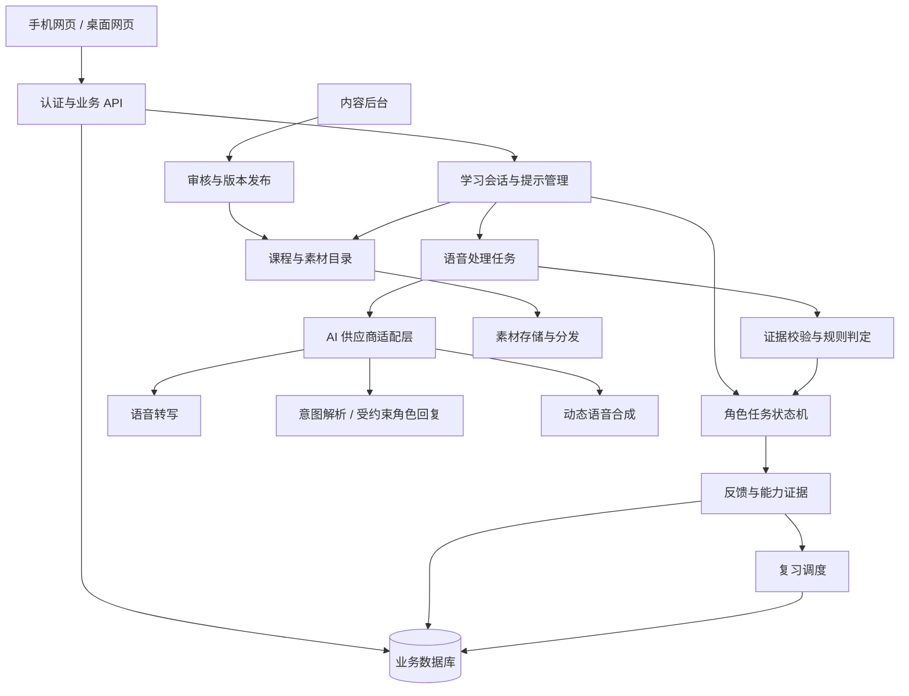

# Scene English：场景英语学习产品 PRD 与设计架构

版本：v0.1 · 日期：2026-11-04 · 状态：待用户访谈与原型验证

## 1. 产品决策摘要

**一句话定位：通过图片、动作、声音和互动场景，让成人学习者逐步建立场景与英语表达的直接联系，并练习完成真实交流任务。**

产品工作名为 Scene English，中文暂称「入境英语」。名称仅用于本方案，未进行商标或域名可用性核查。

默认假设：面向中文母语成年初学者；以个人日常交流为目标；每天学习 10—15 分钟；先做手机优先的网页，验证后再决定是否开发独立 App。本文所有功能范围、数值门槛、工期与成本约束均为设计建议，未经真实用户与线上数据验证。

首版最重要的结果是：用户离开示范句、换一张图片或一种问法后，仍能用简单英语完成任务。产品不推断用户脑内是否出现中文，也不把「使用中文次数少」直接当成英语水平高。

### 1.1 对学习理念的取舍

保留用户的核心偏好：学习任务默认无中文翻译，不以中译英、英译中作为主线。新词先用可观察的对象、动作和结果展示；有基础后再加入简单英文解释。

需要区分「减少逐句翻译依赖」与「所有中文辅助都有害」。母语与英语释义的比较研究结果随学习材料、水平和任务变化，不能据此宣称全英语适合所有阶段、或必然优于所有翻译辅助。[S2][S3]

据此作出以下产品决策：

- 学习区默认只呈现英语和视觉线索；系统设置、录音授权与支付等操作信息允许用户选择中文。
- 提供「严格沉浸」和「辅助沉浸」。两者均默认无中文；只有辅助模式允许用户主动请求一次简短中文释义。
- 严格沉浸中遇到困难，依次通过重播、慢速音频、视觉对比、动作演示、熟词例句、局部示范降低难度，不自动切换中文。
- 英语语法通过对比、时间线、角色关系和句型变换呈现；需要时给一句简短英文规则，而非省略语法教学。
- 将「更容易理解」「更愿意开口」「减少提示后仍能交流」列为待验证假设，避免承诺母语水平或固定天数达成流利交流。

### 1.2 学习能力边界

课程设计参考 CEFR 能做描述：A1 涉及基本日常表达、个人信息和在他人配合下进行简单互动；A2 涉及熟悉、日常任务中的直接信息交换；B1 才进一步涉及处理旅行中的多数情况、连贯叙述和简单说明理由。[S1]

首版只覆盖部分 Pre-A1/A1 能力点，并设计向 A2 的衔接，**不宣称完成首版课程即通过完整 CEFR 等级认证**。后续以 A2 日常任务、B1 常见情境应对为产品路线，而非首版交付承诺。

## 2. 用户与需求

### 2.1 核心用户

| 用户 | 当前困难 | 最迫切的结果 | 首版策略 |
|---|---|---|---|
| 成年零基础用户 | 不认识单词，也听不懂英文解释 | 先听懂并说出极简单需求 | 无文字可开始，基础桥接课 |
| 学过但不敢说的用户 | 做题熟练，交流时逐词组织、容易停住 | 在熟悉场景中直接回应 | 可跳过基础，尽早进入角色任务 |
| 有明确出行需求的用户 | 学习内容与实际需求脱节 | 点餐、购物、问路、简单自我介绍 | 按场景目标进入课程 |

首版不覆盖儿童课程、考试备考、专业商务谈判及高级写作。儿童与考试分别需要不同的内容、交互和评价设计。

### 2.2 待验证的用户任务

1. 当我想要一杯水时，我能直接说出简单请求。
2. 当对方换一种问法时，我能识别核心意思并继续回应。
3. 当我没听懂时，我能请求重复、放慢或确认。
4. 当我描述不清时，我能借助简单词或指代完成交流。
5. 当我再次学习时，系统能安排我真正容易忘的表达。

### 2.3 首轮访谈

建议先访谈 5—8 位目标用户，包含完全初学者与学过但开不了口者。使用真实任务观察：播放一句短英语、让用户操作或回应，记录卡点。重点询问过往学习经历、最想使用的场景、能接受的录音方式、无中文时的挫败点、设备与网络条件。访谈人数为探索性建议，不代表样本已经充分。

## 3. 学习体验与课程架构

### 3.1 一次学习闭环


「选择题答对」只记录理解证据；「跟读成功」只记录模仿证据；独立完成有信息变化的任务才记录自主表达证据。不同证据不可相互替代。

### 3.2 零基础如何开始

初次打开不要求阅读长篇英文说明，也不强制完成考试。先看一段无文字操作演示，体验「听 → 点选 → 出现结果」。

四节基础桥接课建议如下，每节 5—8 分钟，可根据诊断跳过：

| 基础课 | 视觉与操作 | 语言目标 |
|---|---|---|
| 对象与指向 | 水、杯子、咖啡；不同实物实例 | water / cup / coffee / this |
| 人与动作 | 角色指自己、指对方；拿起、给予 | I / you；take / give；短指令理解 |
| 数量与选择 | 一件与两件、大杯与小杯、是与否 | one / two；big / small；yes / no |
| 简单需求与求助 | 角色缺水、得到水；对话重播 | Water, please. / I want water. / Again, please. |

同一词至少配置不同外观的实例，避免用户只记住特定图片。一个画面存在多种合理解释时，增加动作或前后结果，不让用户猜作者意图。

初期不使用「coffee = a beverage made from...」这类带来更多生词的长定义。学习引擎优先检查释义依赖词；用户不认识依赖词时改用图片或动作，不递归弹出更多英文解释。

### 3.3 从具象到抽象

| 内容类型 | 表达方式 | 示例 |
|---|---|---|
| 实物 | 多图实例、声音、点选对象 | cup / water |
| 动作 | 短动画、角色操作、动作前后对比 | open / close / give |
| 空间关系 | 可拖动对象与位置变化 | in / on / under |
| 属性 | 只改变一个属性的成对画面 | hot / cold；big / small |
| 时态与数量 | 时间线、前后状态、单复数对比 | I walk / I walked；one cup / two cups |
| 意图与礼貌 | 同一场景的角色反应、可接受表达对比 | Water, please. / I'd like some water, please. |
| 原因与抽象概念 | 连续情境和已知词组成的短解释 | because；need / want 的情境区别 |

表中部分内容属于后续课程扩展，首版仅选择与四个场景有关的少量对比。

### 3.4 单节课程结构

场景课 10—15 分钟，建议节奏如下，时间不是强制倒计时：

| 阶段 | 时间参考 | 用户行为 | 主要证据 |
|---|---|---|---|
| 进入场景 | 1 分钟 | 看人物、对象和任务目标 | 是否理解目标 |
| 理解输入 | 2—3 分钟 | 听短句，选对象或执行动作 | 听懂关键意思 |
| 模仿表达 | 2 分钟 | 听示范、录音、回放 | 是否愿意尝试与模仿 |
| 完成任务 | 3—4 分钟 | 与角色进行 3—5 轮交流 | 是否自主传递信息 |
| 变化与回顾 | 2—3 分钟 | 换对象、问法或人物，再完成一次 | 是否依赖固定台词 |

每课先以 3—5 个新表达为内容上限建议，根据卡点调整。学习难度由内容团队检查句长、依赖词、语速和任务复杂度，不把一个粗略词汇百分比当作可理解的保证。

### 3.5 提示阶梯

提示按用户主动请求或连续卡顿逐级出现，并可随时关闭：

0. 独立尝试：场景目标和角色声音。
1. 重播或慢速重播。
2. 高亮相关对象、数量或动作。
3. 用已学词给更短的英文例句。
4. 提供句首、关键词或部分示范。
5. 提供完整示范，允许再模仿一次。
6. 辅助沉浸模式下，用户主动请求简短中文释义。

请求完整示范后可以继续课程，但该次不计为独立完成；下一次用新任务重新验证。严格沉浸模式不出现第 6 级。

### 3.6 反馈原则

- 对话时先回应用户要表达的意思，优先保证任务能继续。
- 每轮最多给一个最影响理解的纠正；其他问题可在结束时回顾。
- 意思明确但句式不完善时接受，例如小杯咖啡任务中的 “Small coffee, please.”。
- 需要完整句式练习时，可以另设练习目标，但不把它混为现实交流成功的唯一标准。
- 录音无法可靠辨认时提示重录或确认识别文本，不能直接判英语错误。
- 首版只给表达建议与识别反馈，不显示未经验证的「母语相似度」「口音等级」或音素分。

## 4. MVP 功能范围

### 4.1 首版交付

首版共 **20 个学习单元：4 节基础桥接课 + 4 个场景 × 每场景 4 节课**。各场景的第 4 课包含未见过的平行任务；其他课末也安排短变式。内测可先发布咖啡场景的完整纵向流程，再补齐其余场景。

| 场景 | 逐步目标 | 迁移任务示例 |
|---|---|---|
| 咖啡店 | 请求饮品、选择大小、确认堂食或外带 | 换饮品和问法，独立完成订单 |
| 商店 | 指定对象、问价格、说明数量、表达选择 | 换商品和数量，确认购买内容 |
| 问路 | 找地点、听懂简单方向、请求重复 | 换地图和目的地，确认路线 |
| 认识新朋友 | 介绍姓名与来源、交流简单喜好 | 换角色与提问顺序，保持短对话 |

基础词与表达的总量在课程脚本审核后统计，不先用「掌握若干千词」作为卖点。先保证每个目标有可理解输入、主动表达和迁移证据。

### 4.2 功能优先级与验收

| 功能 | 优先级 | 行为与验收要求 |
|---|---|---|
| 首次体验与简短诊断 | P0 | 可不注册试学；看不懂文字也能开始；支持跳过或重测 |
| 互动场景播放器 | P0 | 图片、音频、字幕开关和操作同步；素材有版本；失败可重试 |
| 点选和拖动理解任务 | P0 | 正误由明确规则判定；对象位置变化不会改变答案语义 |
| 按住或点击录音、回放、重录 | P0 | 有明确录音状态；离开页面停止录音；权限拒绝后保留其他练习 |
| 有目标的角色对话 | P0 | 任务状态驱动；3—5 轮；允许多种合理回答；能处理请求重复 |
| 提示阶梯 | P0 | 所有提示计入记录；严格沉浸不显示中文；提示后不误计独立完成 |
| 课后反馈与复习队列 | P0 | 区分理解、模仿、表达；复习使用新实例；支持重复提交去重 |
| 进度保存与基础账号 | P0 | 访客先学习；注册后可合并进度；重新进入可续学 |
| 课程内容管理 | P0 | 发布前审核；可预览、版本回滚；题库与评估库分离 |
| 数据采集、反馈入口、录音删除 | P0 | 错误可上报；用户可删录音；最少采集个人信息 |
| 字幕逐步隐藏与语速偏好 | P1 | 默认策略随阶段变化；用户可手动覆盖并记录 |
| 个性化薄弱项推荐 | P1 | 有足够证据后排序；允许用户自主选择复习 |
| 实时打断式语音、相机识物、口型评分 | 后续 | 不进入首版，待核心闭环验证后评估 |
| 真人社区、排行榜、开放世界、完整付费体系 | 后续 | 不进入首版；先验证学习价值与持续使用 |

P0 为内测可用版本必须具备；P1 在 P0 稳定后加入。语音权限被拒时可完成理解和文字/点选演练，但页面明确显示「口语能力尚未验证」，不把替代操作计为口语成功。

## 5. 页面与交互设计

### 5.1 信息架构

```text
学习端
├── 首次体验：目标选择 → 操作演示 → 简短诊断 → 第一课
├── 今天：继续学习、到期复习、一个可完成的今日任务
├── 场景：四类场景 → 能做目标 → 课程 → 任务
├── 复习：待复习表达、变化任务、重新挑战
└── 我的：能力证据、学习记录、沉浸设置、语音与数据设置

内容后台
├── 场景与课程编辑
├── 素材、例句与依赖词管理
├── 角色状态机与任务判定
├── 评估题库与人工复核
└── 审核发布、版本与成本监控
```

### 5.2 首页

只突出一个下一步：继续当前任务，或先做 2 分钟复习。展示「我能请求一杯饮品」这类具体能力和最近证据；词数、连续天数不占核心位置。未完成的能力显示「练习中」，不能凭学习时长自动变成「已掌握」。

### 5.3 学习页线框

```text
┌──────────────────────────────────┐
│ ‹  At the café            2 / 5   │
│                                  │
│       柜台、店员、两种杯型         │
│       目标卡：小杯咖啡 + 外带图示   │
│                                  │
│       “Small or large?”           │
│       [ Replay ] [ Slower ]       │
│                                  │
│       [ Record your answer ]     │
│       [ Help ]                   │
└──────────────────────────────────┘
```

图示表达任务目标，英语字幕可隐藏。关键控件有图标、状态与简短英文标签；首次通过操作演示说明含义。录音后先允许回放或重录，再提交给角色。不要同时堆满翻译、语法树、波形图和分数。

### 5.4 反馈页

显示三件事：你完成了什么、下次只改进什么、下一次如何练习。

示例反馈：

> You ordered a small coffee. Next: try asking for it without the example.

有基础后再补充一句自然表达示范。后台可以保留详细证据，但用户界面避免难解释的综合分数。

### 5.5 交互、视觉与可访问性

- 成人友好的简洁场景插画或短片，信息清楚优先于装饰。
- 每屏一个主要动作，主要录音按钮易于触达，触控目标建议至少 44×44 CSS 像素。
- 画面中的颜色变化同时配合位置、形状或文字，不只用红绿区分正确与错误。
- 支持键盘完成核心流程、明确焦点、屏幕阅读器标签、减少动态效果。
- 文字标签优先使用动作词；音频有字幕替代；视觉任务有可理解的替代说明。
- 字幕、替代文本和纯音频任务代表不同测试条件，评分时记录支持方式。依赖视觉的练习不应直接宣称测到了视障用户同等的听力能力。
- 第一阶段优先适配手机竖屏，并覆盖桌面浏览器；无麦克风、弱网和音频无法自动播放均有可继续操作的状态。

## 6. 一节完整示例课：在咖啡店点单

### 6.1 前置要求与分支

用户已通过基础课理解 coffee、small、large、please，以及选择问题的操作。零基础用户先用 “Coffee, please.” 请求，再用 “Small, please.” 回应；已有基础的用户可以使用 “I'd like a small coffee, please.”。后者是可学变体，不是唯一标准答案。

本课先把 `to go / for here` 作为整体表达，通过角色携带杯子离开与坐下饮用的短动画建立意思。尚未教过时，不突然把它作为无提示测验。

### 6.2 逐步脚本

| 步骤 | 系统呈现 | 用户操作 | 结果 |
|---|---|---|---|
| 1 理解对象 | 三张不同咖啡图片与声音 coffee | 听音选择咖啡 | 换图片验证词义 |
| 2 理解对比 | 同一种饮品的大杯/小杯 | 听 small / large 并点选 | 建立属性对比 |
| 3 表达需求 | 店员示范 “Coffee, please.” | 听、录音、回放 | 记录模仿证据 |
| 4 角色任务 | 目标卡显示小杯咖啡 | 用户主动请求 | 更新订单中的饮品/杯型 |
| 5 追问 | 若杯型缺失，店员问 “Small or large?” | “Small, please.” | 填补缺失信息 |
| 6 使用方式 | “For here or to go?” | “To go, please.” | 更新订单方式 |
| 7 确认 | 展示小杯咖啡外带订单，店员确认 | 确认或更正 | 目标状态达成 |
| 8 迁移 | 换为大杯茶，店员改变问法 | 不看示范再完成 | 独立计分或安排提示 |

### 6.3 成功与失败定义

成功：最终确认订单的饮品、大小与方式符合目标，并由用户传递这些关键信息。若店员完整说出答案、用户只点击“是”，不计同等自主表达证据。

可接受：“A small coffee, please.”、“Can I have a small coffee?”、“Coffee, please.” 后续补充 “Small.”。不要求与示范逐字相同。

部分成功：说明了饮品，但未传递大小；或完整示范后才完成。任务可结束，系统标记需要再练。

待确认：录音不清、转写明显不可信或意图冲突。系统要求重说、确认文字或重新选择；不能把模型猜测当作确定成功。

## 7. 评估、复习与个性化

### 7.1 分开记录四类能力

| 能力 | 证据 | 不能推出什么 |
|---|---|---|
| 听懂 | 新录音下选对或执行正确 | 不能推出会说 |
| 模仿 | 听过示范后复述 | 不能推出能自主组织 |
| 表达 | 无完整示范时传递必要信息 | 不能推出所有场景都会 |
| 应对 | 请求重复、澄清或修正误解 | 不能推出发音完全准确 |

阅读支持、提示级别、语速和输入方式随证据记录。课程等级只是内容标签，正式 CEFR 水平需要更全面的独立评估。

### 7.2 复习策略

间隔练习在词汇学习中有研究支持，但词汇测验收益不能直接等同于流利交流；不同知识类型的收益也可能不同。[S4][S5] 因此本产品同时设计间隔复习和实际对话迁移。

首版采用可解释规则：学习后在次日、约第 3 天、第 7 天安排提取练习。上述间隔是待验证的实现起点，不是对所有学习者最优的科学常数。忘记或依赖完整示范时缩短间隔；跨日、跨实例独立成功后延长。

每次复习优先用「新画面听懂 → 主动说出 → 简短追问」中的合适一步，不只重复看原卡片。到期内容过多时控制当日队列，避免复习无限挤压新学习。

「已能独立完成」的初始产品规则：同一能力在至少两个不同日期、累计三次无完整示范成功，其中至少一次使用未见过的实例。该规则只生成本产品内的能力状态，仍需后续验证其预测价值。

### 7.3 北极星指标

**每周独立完成迁移口语任务的学习者数。**

口径：按用户去重；任务来自未在教学中出现的平行任务库；无完整答案和句首模板；语音输入；最终状态达成且用户传递关键槽位。重播和请求放慢可以使用，但单独报告使用情况。旁边同时报告符合评估条件的人数与成功率，避免单纯拉高参与人数掩盖效果。

### 7.4 其他指标与初始门槛

以下是内部决策门槛建议，非行业基准与效果承诺：

| 指标 | 口径 | 初始门槛/用途 |
|---|---|---|
| 首课完成 | 完成首课的访客 / 开始首课的访客 | 目标 ≥70%，找出理解与操作障碍 |
| 首次语音参与 | 至少提交一次语音 / 麦克风可用且进入口语步骤者 | 目标 ≥60%，同时报告权限拒绝率 |
| 七日学习留存 | 首次学习后第 7 天再次完成有效任务的人 / 首次有效学习者 | 目标 ≥25%，按起点水平分组 |
| 迁移变化 | 后测无提示任务成功率 − 前测平行任务成功率 | 探索性目标提高 ≥20 个百分点 |
| 持续性 | 7 天后延迟后测表现 | 查看是否仅有当堂记忆 |
| AI 误判 | 人工复核与系统任务结论不一致的次数 / 抽查次数 | 目标 <10%，严重错误单列 |
| 成本效率 | 课程可变成本 / 有效完成课程数 | 根据实际报价与付费意愿决定上限 |

完成时间、响应起始时间可以辅助分析，但不单独代表英语思维；用户可能在思考、紧张或遇到设备延迟。

### 7.5 试点验证

建议 20—30 位成年用户进行 21 天探索性内测，按零基础/学过但开不了口分组。基线、结束和结束 7 天后的延迟测试均使用难度接近、内容不同的任务，并尽量打乱版本顺序；盲审人员不知道录音来自哪个测试阶段。

小样本先判断可用性、参与度与信号方向，不宣称证明因果。若需要比较英语沉浸与翻译辅助，再设计学习时长、任务难度、反馈和材料一致的随机对照试验，提前约定指标与样本量。仅比较「完整本产品」与「单纯背单词」不能归因于有无中文。

## 8. 技术架构

### 8.1 首版实现建议

使用手机优先的响应式 Web/PWA 思路；PWA 的安装与离线能力以目标设备验证结果为准。前后端可采用团队熟悉的 Web 技术，逻辑上划分课程、对话、评估与复习模块，物理上先保持模块化单体，不提前拆成微服务。

以下为候选实现组合，未绑定具体云服务或模型供应商，也未进行版本、采购、地区可用性和报价核验：

| 层次 | 建议 | 作用 |
|---|---|---|
| 学习前端 | TypeScript + React 或同类框架 | 场景播放器、录音、提示与反馈 |
| 内容后台 | 与学习端共享组件，独立权限 | 课程编辑、审核与发布 |
| 业务服务 | TypeScript/Node.js 或团队熟悉的后端 | 会话、任务状态、评估与学习记录 |
| 数据库 | PostgreSQL 或同类关系数据库 | 用户、版本、会话与能力证据 |
| 素材存储 | 对象存储 + CDN | 图片、审核音频、短动画 |
| 异步任务 | 数据库任务表起步；需要后引入队列 | 转写、生成反馈、合成缓存音频 |
| AI 适配层 | 可替换的 ASR、语言模型、TTS 接口 | 供应商替换、限流、成本与故障处理 |
| 观测 | 业务事件、结构化日志、延迟和费用记录 | 学习漏斗、错误分析、成本控制 |

### 8.2 系统结构



### 8.3 为什么对话需要状态机

用户看起来在与店员交流，系统内部需要明确订单和任务进展。教学大纲、正确目标和完成条件由已审核内容与规则保存；模型负责理解多样表达、生成受约束的追问与反馈。模型不能随意修改目标或直接给自己判通关。

咖啡订单状态示例：

```text
开始 → 收集饮品 → 收集大小 → 收集堂食/外带 → 确认订单 → 完成
                           ↘ 请求重复 / 澄清 / 更正 ↗
```

允许用户一句话一次填多个槽位，也允许更正前面信息；状态机根据当前缺失信息决定追问，不强迫所有人走完全一致的台词。槽位必须能指回用户某一轮表达；角色代说的信息不能算作用户提供。

### 8.4 一次语音回答的处理链

1. 前端在用户操作后录音，展示状态，限制单次长度并允许回放重录。
2. 使用短期授权上传音频；业务服务校验会话、文件大小、类型与时长。
3. 创建处理任务并返回任务编号；客户端显示处理中，可查询结果。
4. ASR 转写；结合转写证据与供应商可用信息决定是否需要用户确认。
5. 模型输出结构化的意图、槽位、来源文本、是否需要澄清，而不是任意自由文本控制业务。
6. 服务端按内容版本、槽位枚举、证据来源、状态机规则校验；不确定则澄清。
7. 保存评估、提示条件与版本；更新任务状态，生成一条角色回复。
8. 优先播放已审核的缓存音频；只有必要时生成动态语音。
9. 完成后生成反馈与复习项。客户端断线重连后查询同一任务，避免重复扣费或重复计分。

AI 返回的自报置信度仅是启发式信息，不视为经过校准的概率。首版用人工标注样本确定澄清规则，持续检查不同口音和设备条件下的误判。

### 8.5 AI 角色约束

角色提示词输入包括场景、教学目标、已审核表达、允许的词汇范围、当前槽位、用户已知能力和允许提示级别。强制结构化输出，限制回复长度；对超出课程范围的生成进行检查，必要时回退到审核模板。

默认不允许用户在对话中改变系统规则、索取答案并计为独立完成，或把偏题讨论当作学习成功。用户主动问词义时进入独立帮助流程，并记录提示级别。用户输入仅作学习材料，不执行代码或访问外部资源。

首版不依赖向量数据库：20 个单元可通过内容 ID 与标签检索。未来课程、文本和素材规模确有需要时再加入检索增强。

## 9. 核心数据模型与接口

### 9.1 内容、行为、证据分开存储

| 实体 | 关键字段 | 设计理由 |
|---|---|---|
| Learner | id、起点、目标、界面语言、沉浸模式、权限偏好 | 界面语言与学习语言分离 |
| Concept | 概念 ID、词形、音频、实例、依赖概念 | 一个概念有多个视觉实例 |
| Expression | 表达、适用意图、依赖词、变体、审核版本 | 同一意图接受多种表达 |
| Scene / LessonVersion | 场景、目标能力、步骤、素材、状态、版本 | 发布后保持历史可重现 |
| TaskVersion | 目标状态、必要槽位、允许值、提示、评估类型 | 区分教学题与平行评估题 |
| Session | 用户、课程版本、当前步骤、开始/结束时间 | 支持续学与退出 |
| Attempt | 幂等键、任务版本、音频引用、转写、支持条件 | 防止重复计分并保留原始证据 |
| Assessment | attempt_id、意图与槽位证据、结论、模型/规则版本 | 可解释与可追查 |
| SkillEvidence | 能力 ID、理解/模仿/表达、日期、实例、新颖性 | 不用一个总分覆盖所有能力 |
| ReviewItem | 能力、到期时间、历史、下次任务条件 | 复习能力而非只复习字符串 |
| ProcessingJob | 状态、阶段、供应商请求、重试、消耗 | 断线恢复与成本追踪 |

### 9.2 任务定义示例

```json
{
  "id": "cafe_order_transfer_01",
  "version": 1,
  "type": "transfer_assessment",
  "skill_ids": ["request_drink", "answer_size", "answer_service_mode"],
  "target": {"drink": "coffee", "size": "small", "service": "to_go"},
  "required_user_slots": ["drink", "size", "service"],
  "max_turns": 5,
  "allowed_support": ["replay", "slower_audio", "ask_to_repeat"],
  "full_model_answer_allowed": false,
  "completion_rule": "target_matches_and_user_supplied_required_slots",
  "content_status": "reviewed"
}
```

### 9.3 意图解析示例

```json
{
  "intent": "request_drink",
  "slot_updates": [
    {"slot": "drink", "value": "coffee", "source_text": "coffee"},
    {"slot": "size", "value": "small", "source_text": "small"}
  ],
  "needs_clarification": false,
  "suggested_reply_key": "ask_service_mode"
}
```

服务端校验 source_text 是否来自该轮用户转写、槽位是否合法、目标是否已确认；不直接接受模型输出的 success 字段。

### 9.4 API 边界建议

| 接口 | 作用 | 要求 |
|---|---|---|
| GET /v1/today | 下一课与复习列表 | 按用户权限返回 |
| POST /v1/sessions | 开始课程 | 固定课程版本 |
| POST /v1/audio-uploads | 获取短期上传授权 | 限制用户、会话与大小 |
| POST /v1/attempts | 提交一次回答 | 幂等键，语音处理返回 202 与 job_id |
| GET /v1/jobs/:id | 查询处理阶段与结果 | 仅所属用户可读 |
| POST /v1/sessions/:id/help | 请求提示 | 服务端记录级别 |
| GET /v1/reviews | 获取到期复习 | 控制当日数量 |
| DELETE /v1/recordings/:id | 删除个人录音 | 同步删除对象与引用 |
| POST /v1/admin/lesson-versions/:id/publish | 发布课程 | 管理权限与审核状态校验 |

## 10. 内容生产与发布流程

```text
选择能做目标 → 写任务与通过条件 → 检查语言前置依赖
→ 制作多实例视觉与音频 → 配置提示与角色状态
→ 语言和教学审核 → 小范围用户试学 → 修订 → 发布版本
```

每个单元的发布清单：

1. 学习目标能用用户行为验证。
2. 新词与句型的前置依赖明确。
3. 图片、动作和音频对应同一个意思，无明显歧义。
4. 不只提供唯一固定台词，明确可接受表达和追问。
5. 有原始内容之外的视觉、录音或信息变化。
6. 无提示评估内容与教学素材分开，避免泄露答案。
7. 素材来源、授权、配音与内容版本可追查。
8. 学习困难、错误回答、无权限与弱网分支经过检查。

生成式 AI 可用于课程草稿、图片草稿与表达变体，首版发布内容仍需人工审核。复杂可变场景优先用可控组件组合，而非每次重新生成整幅图。

## 11. 性能、故障、成本与数据边界

### 11.1 工程验收目标

以下是原型目标，不是已达到的性能：在预先约定的目标设备与网络上，缓存后的场景切换 P95 <1 秒；点击录音后 P95 <0.5 秒出现录音状态；停止录音后 P95 <4 秒开始播放短回复。上线前用真实供应商链路测试；达不到时缩短回答、缓存音频或调整交互预期。

加载较慢时展示清晰处理阶段；约 6 秒仍未完成时给继续等待或重试操作；约 12 秒按超时结束本次处理。重试复用幂等键或明确创建新尝试，不无限重复调用。以上时间同样为待验证参数。

### 11.2 失败与降级

| 情况 | 产品行为 | 数据处理 |
|---|---|---|
| 麦克风拒绝或无设备 | 引导设置；可继续理解练习 | 标为未验证口语 |
| 噪声、空录音、识别异常 | 建议重录或确认转写 | 不判语言错误、不增加独立成功 |
| ASR 或模型不可用 | 使用缓存的理解练习，保留课程位置 | 标记服务失败，与学习错误分开 |
| 动态合成失败 | 用审核短句音频，或展示字幕让用户继续 | 记录降级来源 |
| 网络断开 | 已缓存内容继续；语音提交明确显示未成功 | 恢复后查询原任务，不重复提交 |
| 模型输出不合法或越级 | 丢弃输出，回退模板或澄清 | 记录规则、模型与内容版本 |
| 用户要求重复/放慢 | 用简单句确认并重播 | 算交流策略证据，记录支持条件 |

首版只承诺已缓存课程素材的有限使用，不承诺完全离线口语评估。

### 11.3 成本模型

不预设未经报价核验的单课价格。按实测记录：

`每有效完成课可变成本 =（语音识别时长费用 + 模型输入输出费用 + 动态语音费用 + 存储/传输费用 + 重试浪费）÷ 有效完成课程数`。

固定录音与模板音频提前审核并缓存；仅对用户表达与必要动态回复使用模型；限制轮数和音频长度；把未完成会话与重试也计入分母外的总消耗。扩大使用前，根据实际用户付费意愿决定毛利空间与免费额度。

### 11.4 数据与权限

所有供应商密钥保留在服务端；管理后台有独立角色权限；音频读取使用短期授权。请求日志尽量不记录原始录音和可识别信息。首版原始录音仅为完成处理而临时保留，建议 24 小时内自动删除；用户主动保存用于回听或另行同意质量复核的录音采用明确、独立的保存策略。

学习进度、转写、评估和备份分别定义保留与删除周期；删除录音不等于自动删除全部文本。录音质量复核应单独征求同意；外部供应商留存、处理地区与相关条款在选型时核查。这里是产品与工程要求，不是法律合规结论。

## 12. 开发路线与验收

### 12.1 分阶段路线

假设团队有 1 名产品/课程负责人、1 名前端、1 名后端，设计与英语教学审核可兼职支持；8—10 周为规划估算，需在课程脚本与供应商验证后调整。若主要由个人开发，应优先缩小为一个场景，单独重估排期。

| 阶段 | 参考时间 | 可审查交付物 | 继续投入条件 |
|---|---|---|---|
| 需求与教学验证 | 第 1—2 周 | 访谈记录、咖啡课脚本、可点击页面原型 | 用户能看懂输入，愿意尝试说话 |
| 单场景完整流程 | 第 3—4 周 | 基础衔接、录音、任务状态、反馈、初步复习 | 一次课程从开始到迁移任务可闭环 |
| 首版内容与功能 | 第 5—7 周 | 20 单元、内容后台、进度、事件与删除流程 | 关键验收通过，内容可持续发布 |
| 稳定性与内测启动 | 第 8—10 周 | 设备验证、AI 复核集、成本与故障监控 | 可邀请目标用户进入探索性内测 |
| 内测与延迟后测 | 上线内测后另计 | 21 天试用、结束 7 天后后测、复盘 | 根据留存、迁移与误判决定后续 |

### 12.2 开发验收清单

- 严格沉浸模式的学习内容不出现自动中文释义；系统操作语言单独可选。
- 完全初学者可以通过无文字操作演示进入第一节基础课。
- 每个目标至少有理解、模仿或表达的明确阶段，不把跟读自动当作自主表达。
- 同意图的多种合理回答都能推进任务，缺失信息会被追问。
- 完整提示后成功不计为独立成功；未见任务、支持方式可追查。
- 用户一句话填多个槽位或更正前文时，任务状态正确。
- 识别失败、服务失败与语言错误分开；不可信转写不会直接造成通关或失败。
- 语音拒绝、超时、断网、重试、重复提交不丢进度、不重复计分。
- 记录模型、规则和课程版本；可回放匿名化评估过程，人工复核结论。
- 删除录音可验证实际存储对象及引用清除；密钥不在前端。
- 核心页面在目标手机、桌面与键盘操作下可用。

## 13. 产品风险与决策原则

| 风险 | 发现方式 | 应对 |
|---|---|---|
| 全英语导致卡住 | 提示升级、退出点与访谈 | 优先修复视觉与前置依赖，提供可选辅助模式 |
| 认图片却不会英语 | 更换图片、声音与任务后表现骤降 | 多实例输入与无图/新图对照评估 |
| 熟悉台词造成虚假熟练 | 换问法或信息顺序后不会回应 | 未见平行任务、延迟后测 |
| AI 过度宽松或苛刻 | 人工复核，分口音和设备统计 | 状态与证据校验，不用单一主观总分 |
| 只追求不犯错而不敢说 | 录音放弃率与用户反馈 | 先承接意思，减少每轮纠正 |
| 内容生产成为瓶颈 | 单元制作时间与返工率 | 可组合素材、模板与审核清单 |
| 对话延迟和费用过高 | 实测 P95、重试和单课成本 | 缓存、缩短轮次与动态生成范围 |
| 视觉学习偏好被误当普适规律 | 不同用户与任务的表现 | 多模态输入、按证据调整，不给用户贴固定学习类型标签 |

后续商业化可测试「免费基础体验 + 付费场景课程/语音额度」，具体价格待验证。学习价值验证前，不把付费转化、排行榜和签到奖励放到产品核心。

## 14. 研究依据与使用边界

检索核对日期：2026-11-04。以下仅支持教学设计的局部依据，不证明本产品有效，也不证明全英语一定优于其他方式。

- **[S1] Council of Europe，CEFR Global Scale，Table 1 / CEFR 3.3。** 官方 A1、A2、B1 的能做描述，作为课程目标参照；不是本产品的等级认证。
- **[S2] The effect of textual and textual-pictorial glosses on incidental vocabulary learning in mobile-assisted listening，ReCALL，Cambridge University Press。DOI：10.1017/S0958344024000193。** 对 118 位伊朗大学英语学习者的不同释义条件进行研究；母语文字辅助在部分词汇结果中优于英语文字辅助。不能直接推广为中国成年零基础用户所有交流能力的结论。
- **[S3] Effects of L1 and L2 word-level vs. L2 sentence-level glosses on vocabulary learning，System，2024，122：103273。DOI：10.1016/j.system.2024.103273。** 研究比较词级母语/英语与句级英语释义；结果不支持对所有英语解释或母语解释作统一优劣判断。此处依据可检索摘要，未读取付费全文。
- **[S4] Does spaced practice have the same effects on different second language vocabulary learning activities? Fill-in-the-blanks versus flashcards，The Modern Language Journal，2023。DOI：10.1111/modl.12879。** 150 名韩国英语学习者参与的研究，在两周延迟词汇测试中发现间隔练习的优势。不能从词汇测试直接推出会话迁移。
- **[S5] Zheng、Nakata、Clenton、Boutorwick，Effects of spacing on the acquisition of explicit and implicit vocabulary knowledge: An approximate replication of Nakata and Elgort (2021)，Studies in Second Language Learning and Teaching，2026，16(2)：363—393。DOI：10.14746/ssllt.49487。** 研究发现显性词汇收益，但所用隐性测量未发现相应收益。用于提醒区分不同学习结果，不用于断言所有间隔学习都无法促进隐性能力。

